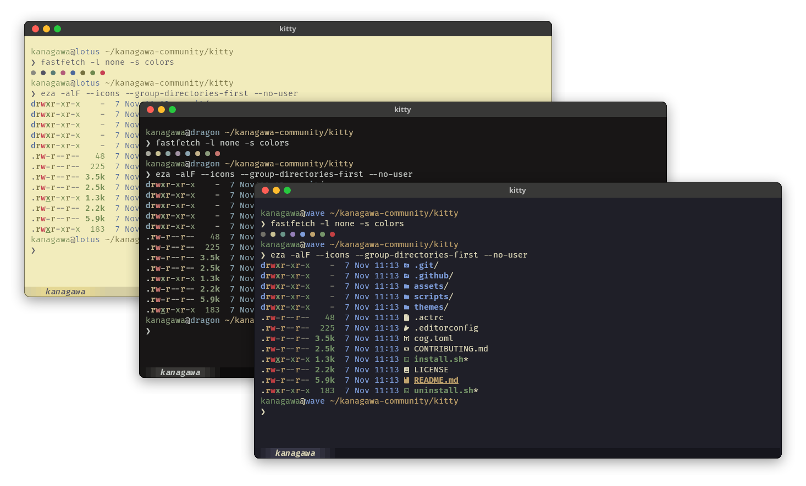
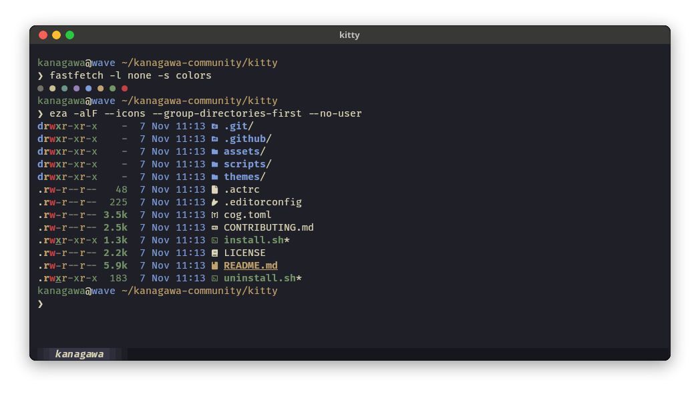
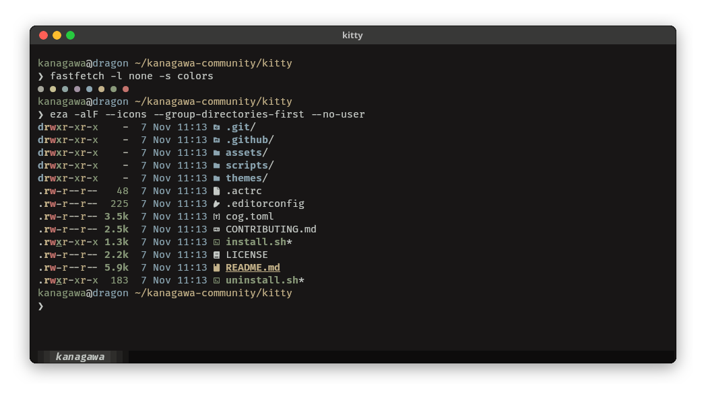
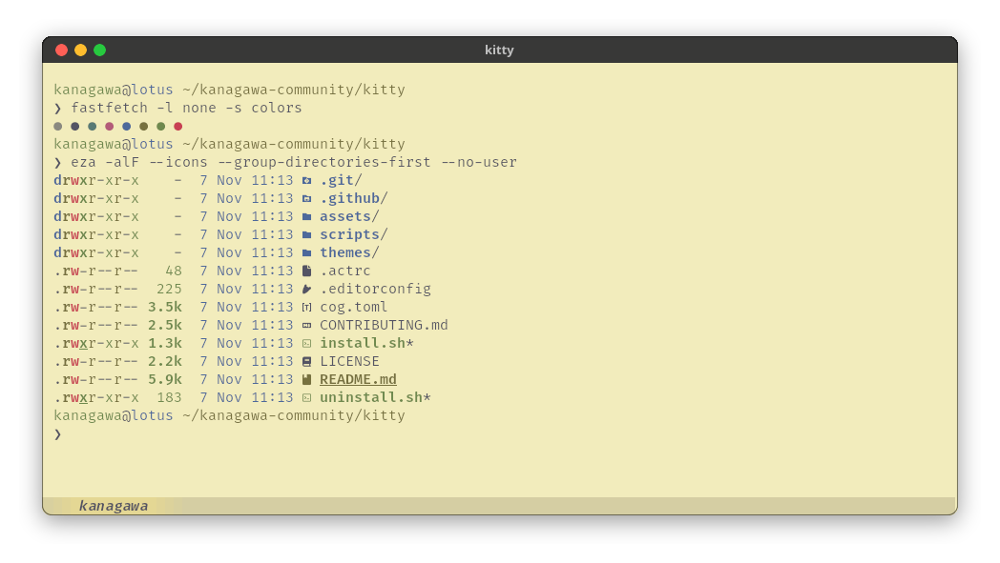

<h3>Kanagawa for <a href="https://sw.kovidgoyal.net/kitty/">kitty</a></h3>
<p>A community-maintained theme inspired by Hokusai's <em>The Great Wave off Kanagawa</em>.</p>
<p>Using the <a href="https://github.com/rebelot/kanagawa.nvim">Kanagawa palette</a> by <a href="https://github.com/rebelot">Tommaso Laurenzi (rebelot)</a>.</p>

<!-- Wave accents: carpYellow, crystalBlue, autumnRed. Lotus accents: lotusYellow, lotusBlue4, lotusRed. -->
<p>
  <a href="https://github.com/kanagawa-community/kitty/stargazers">
    <picture>
      <source media="(prefers-color-scheme: dark)" srcset="https://img.shields.io/github/stars/kanagawa-community/kitty?style=for-the-badge&amp;labelColor=1F1F28&amp;color=E6C384">
      <source media="(prefers-color-scheme: light)" srcset="https://img.shields.io/github/stars/kanagawa-community/kitty?style=for-the-badge&amp;labelColor=F2ECBC&amp;color=77713F">
      
    </picture>
  </a>
  <a href="https://github.com/kanagawa-community/kitty/releases/latest">
    <picture>
      <source media="(prefers-color-scheme: dark)" srcset="https://img.shields.io/github/v/release/kanagawa-community/kitty?style=for-the-badge&amp;label=release&amp;labelColor=1F1F28&amp;color=7E9CD8">
      <source media="(prefers-color-scheme: light)" srcset="https://img.shields.io/github/v/release/kanagawa-community/kitty?style=for-the-badge&amp;label=release&amp;labelColor=F2ECBC&amp;color=4D699B">
      
    </picture>
  </a>
  <a href="https://github.com/kanagawa-community/kitty/issues">
    <picture>
      <source media="(prefers-color-scheme: dark)" srcset="https://img.shields.io/github/issues/kanagawa-community/kitty?style=for-the-badge&amp;labelColor=1F1F28&amp;color=C34043">
      <source media="(prefers-color-scheme: light)" srcset="https://img.shields.io/github/issues/kanagawa-community/kitty?style=for-the-badge&amp;labelColor=F2ECBC&amp;color=C84053">
      
    </picture>
  </a>
</p>

<br clear="both">
<br>

## Previews



<details>
<summary>🌊 Wave</summary>

</details>

<details>
<summary>🐉 Dragon</summary>

</details>

<details>
<summary>🪷 Lotus</summary>

</details>

## Requirements

- kitty 0.26 or later, for `kitten themes`.

## Installation

Download the three themes into ~/.config/kitty/themes:

```sh
mkdir -p ~/.config/kitty/themes
for variant in wave dragon lotus; do
  curl -fsSL -o ~/.config/kitty/themes/kanagawa-$variant.conf https://raw.githubusercontent.com/kanagawa-community/kitty/main/themes/kanagawa-$variant.conf
done
```

Or clone the repository and run `./install.sh`. It installs all three variants,
or only the ones you name, for example `./install.sh dragon lotus`. `./uninstall.sh`
takes the same names and removes them.

## Usage

Run `kitten themes`, open the **User** category, and choose Kanagawa Wave,
Kanagawa Dragon or Kanagawa Lotus. Or include a theme in `~/.config/kitty/kitty.conf`:

```conf
include themes/kanagawa-wave.conf
```

## Palette

Every color comes from the shared
[palette](https://github.com/kanagawa-community/.github/blob/main/docs/PALETTE.md),
picked by role, so each variant uses its own value for the same role.

| kitty color                                                   | Palette role                         |
| ------------------------------------------------------------- | ------------------------------------ |
| `background`, `cursor_text_color`                             | `ui.bg`                              |
| `foreground`, `selection_foreground`, `active_tab_foreground` | `ui.fg`                              |
| `selection_background`                                        | `ui.bg_visual`                       |
| `cursor`, `active_border_color`, `inactive_tab_foreground`    | `ui.fg_dim`                          |
| `url_color`                                                   | `syn.fun`                            |
| `inactive_border_color`                                       | `ui.nontext`                         |
| `tab_bar_background`, `inactive_tab_background`               | `ui.bg_m3`                           |
| `active_tab_background`                                       | `ui.bg_p2`                           |
| `color0` to `color15`                                         | `term.*`                             |
| `color16`, `color17`                                          | `term.extended_1`, `term.extended_2` |

## Credits

This port replaces the kitty theme in the `extras` folder of the
[Neovim plugin](https://github.com/kanagawa-community/neovim). Tommaso Laurenzi wrote that theme for kanagawa.nvim. The
colors come from [kanagawa.nvim](https://github.com/rebelot/kanagawa.nvim) by
Tommaso Laurenzi.

## Issues and contributions

Report bugs and request changes in this port's
[issue tracker](https://github.com/kanagawa-community/kitty/issues). Contributions are welcome.

See [CONTRIBUTING.md](CONTRIBUTING.md) before opening a pull request.

## License

MIT. See [LICENSE](LICENSE).
